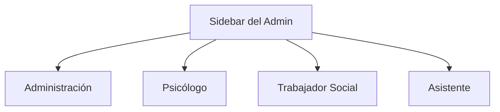

# Roles y permisos

El enum `Rol` en `prisma/schema.prisma` define 5 roles:

```
ADMINISTRADOR · PSICOLOGO · TRABAJADOR_SOCIAL · ASISTENTE · BENEFICIARIO
```

## Qué hace cada rol (en el flujo actual)

| Rol | Qué hace | Dónde vive |
|---|---|---|
| **ADMINISTRADOR** | Acceso total: revisa casos en evaluación, acepta/rechaza beneficiarios, gestiona usuarios, eventos, campañas, donaciones, redes sociales. Ve **todas** las pantallas de todos los roles (ver más abajo). | `pages/private/adminBeneficiarios`, `usuario`, `eventos`, `campana`, `donaciones`, `redes` |
| **TRABAJADOR_SOCIAL** | Registra pacientes nuevos, sube el informe social en PDF, hace la evaluación de vulnerabilidad (con ayuda de IA opcional), y envía el caso directo al administrador. | `pages/private/trabajadorSocial` |
| **PSICOLOGO** | ⚠️ Ya **no participa** en el flujo de evaluación de casos (ver [09-problemas-conocidos.md](./09-problemas-conocidos.md)). Su pantalla sigue existiendo pero llama a endpoints deshabilitados. | `pages/private/psicologo` |
| **ASISTENTE** | Gestiona beneficiarios ya aceptados: sesiones de quimioterapia, solicitudes de ayuda, reportes. Se le asignan beneficiarios al momento en que el admin acepta un caso. | `pages/private/asistente` |
| **BENEFICIARIO** | No tiene acceso web — el frontend lo bloquea explícitamente (`ProtectedRoute`). Solo puede usar la app móvil. | `mobile/` |

## Acceso del Administrador: frontend

`ProtectedRoute.jsx` tiene un bypass explícito: si `user.rol === "ADMINISTRADOR"`, se le permite entrar a cualquier ruta protegida sin importar el `allowedRoles` de esa ruta puntual.

El `Sidebar` refleja esto agrupando la navegación por rol cuando el usuario es admin, para que quede claro de qué rol es cada pantalla:



## Acceso del Administrador: backend

Hay dos capas distintas de autorización en el backend, y **solo una está realmente activa**:

- `middleware/authenticateToken` — verifica que el JWT sea válido. Se usa en pocas rutas (`/api/auth/*`, `/api/ai/*`, `/api/whatsapp-templates`).
- `middleware/rbac.js` (`requireRole`, `requirePermission`, etc.) — sistema de roles y permisos más fino, pero **no está conectado a ninguna ruta activa hoy** (`pacientes.routes.js` y `donaciones.routes.js`, que lo usan, están comentados en `index.js`).

La mayoría de los controladores "legacy" (`Usuario`, `Beneficiarios`, `Donaciones`, `Evento`, etc., montados directo con `app.use(Controller)`) **no verifican rol ni sesión en absoluto**. Es decir: hoy, en la práctica, el admin (y cualquiera con el token correcto, o incluso sin token en muchos casos) puede llegar a casi todos los endpoints.

`config/security.js` define los roles y permisos así (ya corregido para coincidir con el enum de Prisma):

```js
roles: {
  ADMIN: 'ADMINISTRADOR',
  PSICOLOGO: 'PSICOLOGO',
  TRABAJADOR_SOCIAL: 'TRABAJADOR_SOCIAL',
  ASISTENTE: 'ASISTENTE',
  BENEFICIARIO: 'BENEFICIARIO'
}

permissions: {
  ADMINISTRADOR: ['*'],  // todos los permisos
  PSICOLOGO: ['paciente:read', 'paciente:write', 'evaluacion_psicologica:read', 'evaluacion_psicologica:write'],
  TRABAJADOR_SOCIAL: ['paciente:read', 'paciente:write', 'evaluacion_social:read', 'evaluacion_social:write', 'ayuda:read', 'ayuda:write'],
  ASISTENTE: ['solicitud:read', 'solicitud:write', 'reporte:read'],
  BENEFICIARIO: ['paciente:read_own', 'solicitud:read_own', 'solicitud:write']
}
```

Si en el futuro se activa `pacientes.routes.js`/`donaciones.routes.js`, el admin ya tiene bypass garantizado en `requireRole`/`requireRoleOrOwnership`, independientemente de si la ruta puntual lo lista o no en su array de roles permitidos.
