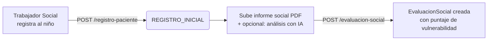
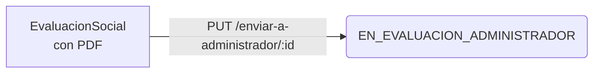
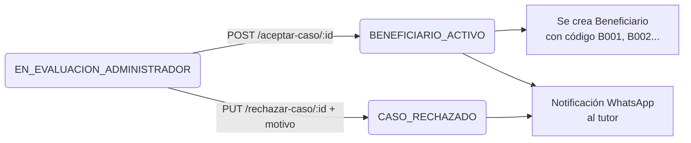
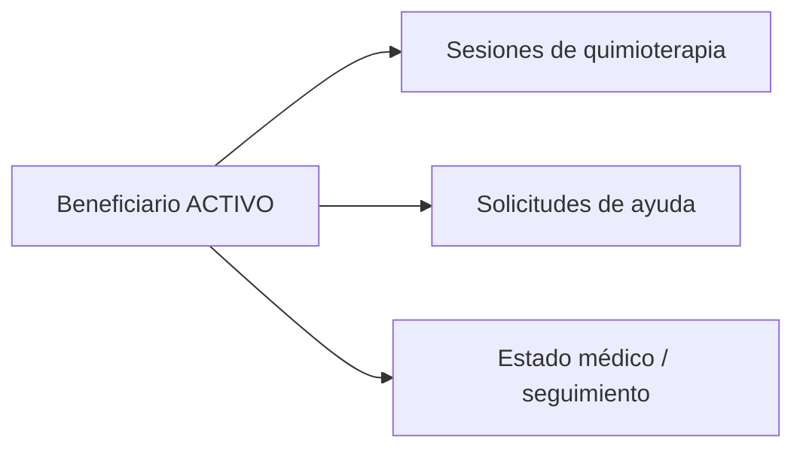
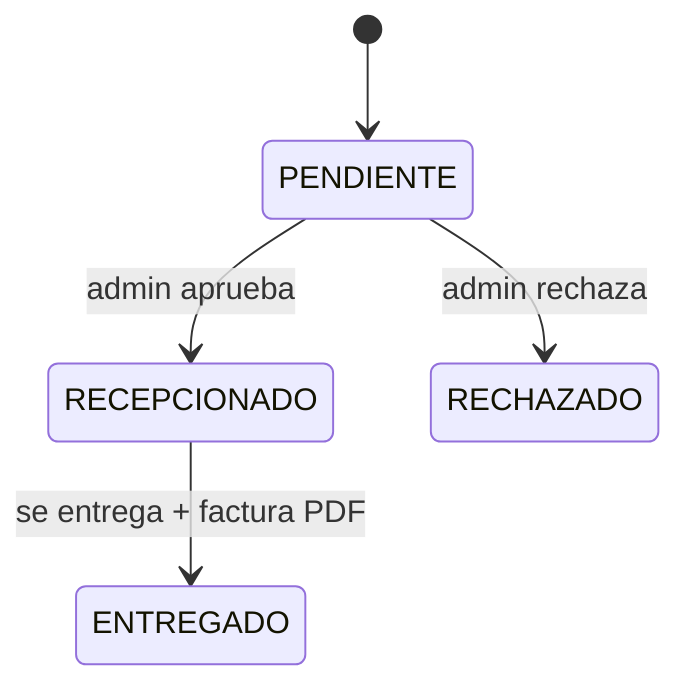
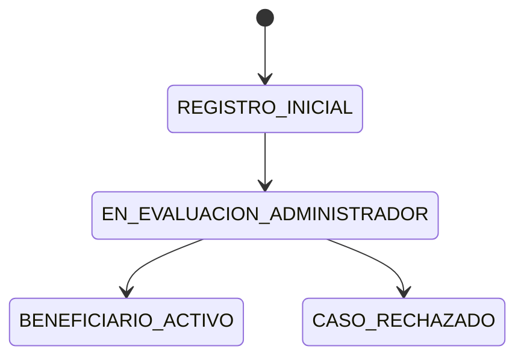

# Flujo de beneficiarios (el proceso central del sistema)

Este es el corazón del sistema: cómo un niño pasa de "registrado" a "beneficiario activo" recibiendo ayuda. Se basa en el modelo `PacienteRegistro` (campo `estado`, enum `EstadoRegistro`).

## Etapa 1 — Registro y evaluación social (Trabajador Social)

- `POST /analizar-informe-social` (opcional): sube el PDF, la IA extrae texto y sugiere puntajes de vulnerabilidad (0-100, ver [07-ia.md](./07-ia.md)).
- `POST /evaluacion-social`: guarda los puntajes (editables manualmente) y el PDF. **Es obligatorio que quede un archivo asociado** (`informeSocialPdf`), si no, el paso siguiente falla.

## Etapa 2 — Envío a administración

Antes de este paso el psicólogo solía intervenir (`/solicitar-evaluacion-psicologica`), pero ese paso está **deshabilitado a propósito** — hoy el trabajador social manda el caso directo al administrador. Ver [09-problemas-conocidos.md](./09-problemas-conocidos.md).

## Etapa 3 — Decisión del Administrador

- `GET /casos-en-evaluacion` lista los pendientes.
- Al aceptar, el admin elige a qué **Asistente** se asigna el caso (`asignadoAId`). Se genera el `codigoBeneficiario` y se envía una notificación de WhatsApp al tutor (ver [06-redes-sociales-whatsapp.md](./06-redes-sociales-whatsapp.md) — hoy en modo prueba por defecto).
- Al rechazar, se guarda el `motivoRechazo` y también se notifica por WhatsApp.

## Etapa 4 — Gestión del beneficiario activo (Asistente)

Las **solicitudes de ayuda** (`SolicitudAyuda`) tienen su propio ciclo de vida:

Tipos de ayuda: `MEDICAMENTOS`, `QUIMIOTERAPIA`, `ANALISIS_EXAMENES`, `OTRO`. Prioridades: `BAJA`, `MEDIA`, `ALTA`, `URGENTE`.

El estado médico del beneficiario (`EstadoMedico`) se actualiza independientemente: `EN_TRATAMIENTO`, `VIGILANCIA`, `PALIATIVO`, `ABANDONO`, `FALLECIDO`.

## Resumen de estados de `PacienteRegistro`

