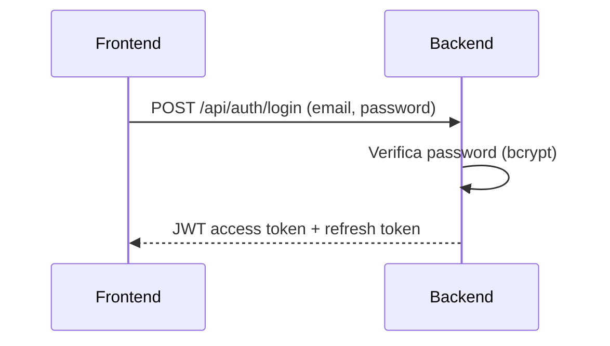
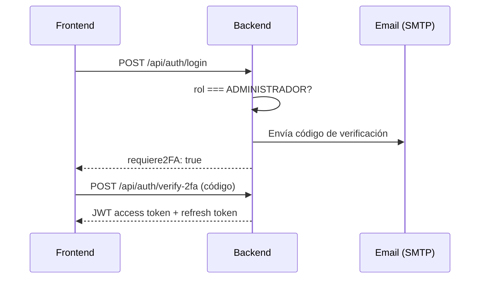

# Autenticación y 2FA

## Login normal



Implementado en `controllers/auth.controller.js` (`login`), montado en `routes/auth.routes.js`. Hay un `controllers/login.js` legacy que **no está montado** (comentado en `index.js`) — no lo uses como referencia.

## Login de ADMINISTRADOR: con 2FA por email



- El código se genera con la longitud configurada en `TWO_FACTOR_CODE_LENGTH` (default 6 dígitos) y expira en `TWO_FACTOR_EXPIRY_MINUTES` (default 10 minutos).
- Si el email no está bien configurado (`EMAIL_USER`/`EMAIL_PASS` en `.env`), el login del admin **queda bloqueado por completo** — no hay forma de saltear el 2FA.

## Tokens JWT

| Token | Duración por defecto | Variable ENV |
|---|---|---|
| Access token | 15 minutos | `JWT_ACCESS_EXPIRY` |
| Refresh token | 7 días | `JWT_REFRESH_EXPIRY` |

El `access token` es el que se manda en cada request como `Authorization: Bearer <token>`. Al expirar, cualquier endpoint protegido con `authenticateToken` devuelve:

```json
{ "success": false, "mensaje": "Token expirado. Por favor, inicie sesión nuevamente." }
```

⚠️ **El backend tiene un endpoint `POST /api/auth/refresh-token` para renovar el access token sin volver a loguearse, pero el frontend nunca lo llama.** Esto significa que, en la práctica, cualquier sesión se corta a los 15 minutos y hay que loguearse de nuevo. Ver [09-problemas-conocidos.md](./09-problemas-conocidos.md).

## Registro de usuarios (staff)

El registro **no usa** `POST /api/auth/register` (ese endpoint existe en las rutas pero no tiene controlador conectado — quedaría colgado). El frontend (`pages/public/register.jsx`) en realidad llama a:

```
POST /usuario   (controllers/usuario.js, legacy, sin autenticación)
```

Este endpoint exige que el propio request incluya el `rol` a crear (`ADMINISTRADOR`, `PSICOLOGO`, `TRABAJADOR_SOCIAL` o `BENEFICIARIO`) — ver el problema de seguridad asociado en [09-problemas-conocidos.md](./09-problemas-conocidos.md).
