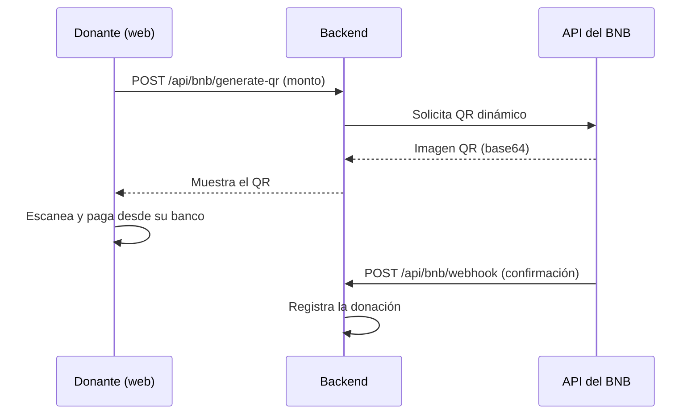
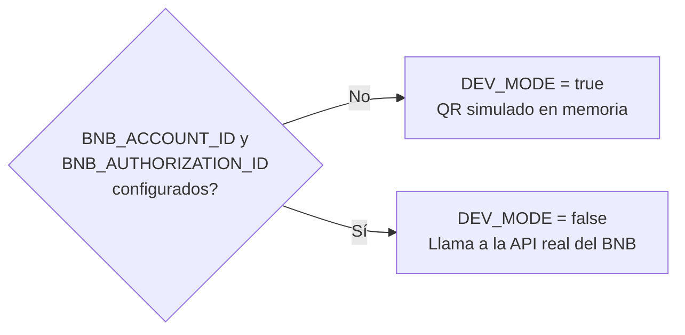

# Donaciones y pagos (BNB)

El sistema genera códigos QR de pago dinámicos usando la API del Banco Nacional de Bolivia. `controllers/bnb.js` tiene un **modo desarrollo (simulado)** que se activa automáticamente si no hay credenciales reales configuradas.

## Flujo de una donación

## Modo desarrollo vs. producción

- En **modo desarrollo**, `POST /api/bnb/generate-qr` genera un QR falso (con `qrId: QR-DEV-...`) y guarda su estado en memoria (`Map`, se pierde al reiniciar el servidor). Se puede simular el pago manualmente con `POST /api/bnb/simulate-payment/:qrId` — útil para probar el flujo sin cuenta real del BNB. Hay un simulador dedicado en el frontend: `/banco-simulador` (`BankSimulator.jsx`), accesible sin login.
- `GET /api/bnb/dev-info` dice en qué modo está corriendo el sistema y qué credenciales faltan.
- En **modo producción**, se necesita `BNB_ACCOUNT_ID` y `BNB_AUTHORIZATION_ID` reales del banco.

⚠️ Las variables documentadas en `.env.example` (`BNB_API_KEY`, `BNB_MERCHANT_ID`, `BNB_CALLBACK_URL`) **no son las que el código realmente lee**. Ver [09-problemas-conocidos.md](./09-problemas-conocidos.md).
