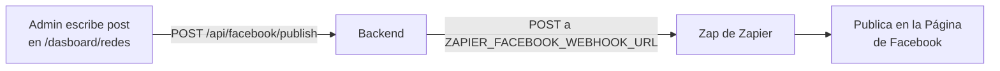
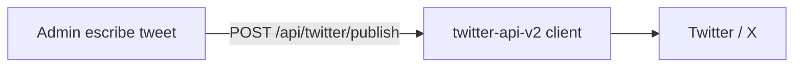
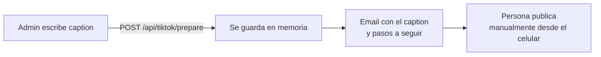
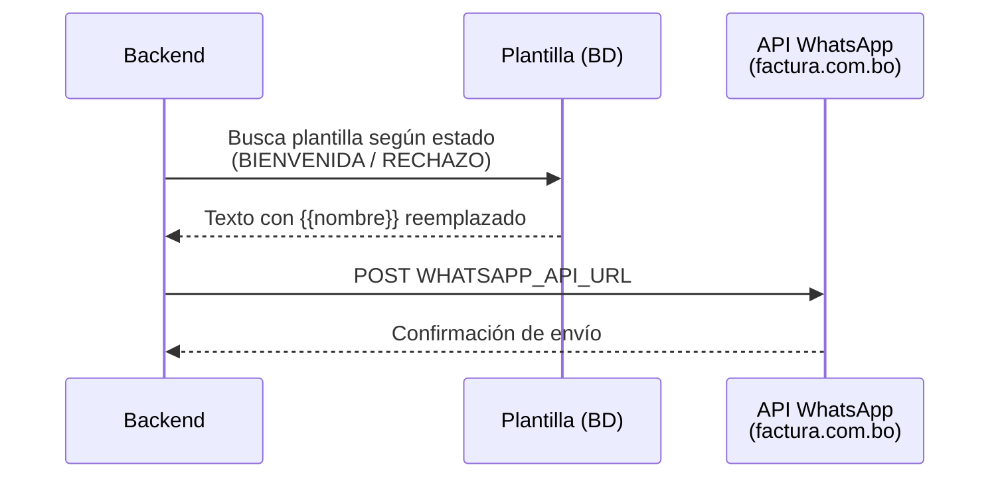

# Redes sociales y WhatsApp

Todo esto vive en `controllers/facebook.js`, `controllers/twitter.js`, `controllers/tiktok.js` y `services/notificacionService.js`. Se administra desde `pages/private/redes/index.jsx` (solo ADMINISTRADOR).

## Facebook — vía Zapier, no la Graph API

No se usa la Graph API de Facebook directamente — todo pasa por un webhook de Zapier configurado en `ZAPIER_FACEBOOK_WEBHOOK_URL`. También soporta publicaciones programadas (`node-schedule`, en memoria — se pierden si el servidor se reinicia).

## Twitter / X — API oficial

Usa las credenciales `TWITTER_API_KEY`, `TWITTER_API_SECRET`, `TWITTER_ACCESS_TOKEN`, `TWITTER_ACCESS_TOKEN_SECRET`. También soporta programación con `node-schedule`.

## TikTok — 100% manual

TikTok no tiene API pública para publicar automáticamente. El sistema solo **prepara** el contenido:

## Notificaciones de WhatsApp a beneficiarios

Se disparan automáticamente cuando el administrador acepta o rechaza un caso (ver [03-flujo-beneficiarios.md](./03-flujo-beneficiarios.md)):

- Las plantillas (`WhatsappTemplate`) se administran en `/api/whatsapp-templates` (requiere login) y se renderizan con Mustache (`{{nombre}}`, etc.).
- **Modo prueba por defecto**: `WHATSAPP_TEST_MODE=true` hace que **todos** los mensajes vayan a `WHATSAPP_TEST_PHONE`, sin importar el teléfono real del tutor. Para notificar a números reales hay que poner `WHATSAPP_TEST_MODE=false` explícitamente en `.env`.
- Si el envío de WhatsApp falla, **no bloquea** la aceptación/rechazo del caso — solo queda logueado como advertencia.

## Formulario de contacto público

`pages/public/contact.jsx` → `POST /api/contact` → usa el mismo SMTP configurado para 2FA (`services/emailService.js`), no un servicio externo como EmailJS. El destinatario es `CONTACT_EMAIL` (o `EMAIL_USER` si no está definido). Tiene rate limiting propio (5 mensajes / 15 min por IP) por ser un endpoint público sin login.
