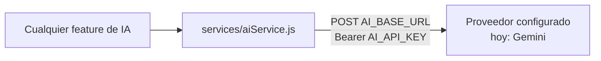
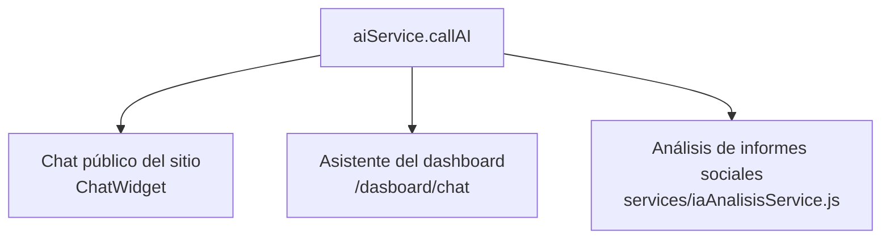

# Inteligencia Artificial

Toda la IA pasa por un único servicio genérico: `services/aiService.js` → función `callAI({ model, messages, max_tokens })`. No está atado a ningún proveedor: habla el formato de "chat completions" estilo OpenAI, que hoy soportan OpenAI, Gemini, OpenRouter, Groq, DeepSeek, etc.

Todo se configura por `.env` (ver [08-configuracion-env.md](./08-configuracion-env.md)): `AI_BASE_URL`, `AI_API_KEY`, `AI_MODEL`. Cambiar de proveedor no requiere tocar código.

## Los 3 usos de la IA en el sistema

1. **Chat público** (`chatbotrasa.jsx`, visible en todas las vistas, sin login): llama a `POST /api/ai/chat` (público, sin auth). Antes apuntaba a un bot Rasa que nunca existió en este repo — se reemplazó por este endpoint.
2. **Chat del dashboard** (`/dasboard/chat`, solo ADMINISTRADOR y PSICOLOGO): llama a `POST /api/ai/generate` (requiere login).
3. **Análisis de informes sociales**: cuando el trabajador social sube el PDF, `analizarInformeSocial()` le pide a la IA que sugiera los 6 puntajes de vulnerabilidad (ver [03-flujo-beneficiarios.md](./03-flujo-beneficiarios.md)). También existe `generarResumenCaso()` para un resumen ejecutivo, aunque no está claro que el frontend lo use activamente.

## Manejo de errores entre proveedores

Distintos proveedores devuelven los errores en formatos distintos (OpenAI: objeto `{error: {...}}`; Gemini: a veces array `[{error: {...}}]`). `aiService.extractErrorMessage()` normaliza ambos casos para que el mensaje de error real le llegue al usuario en vez de un genérico "Error al generar contenido".
