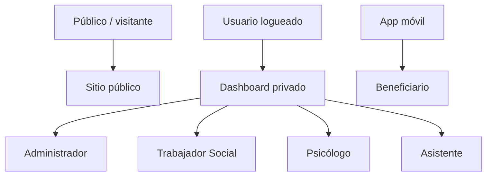
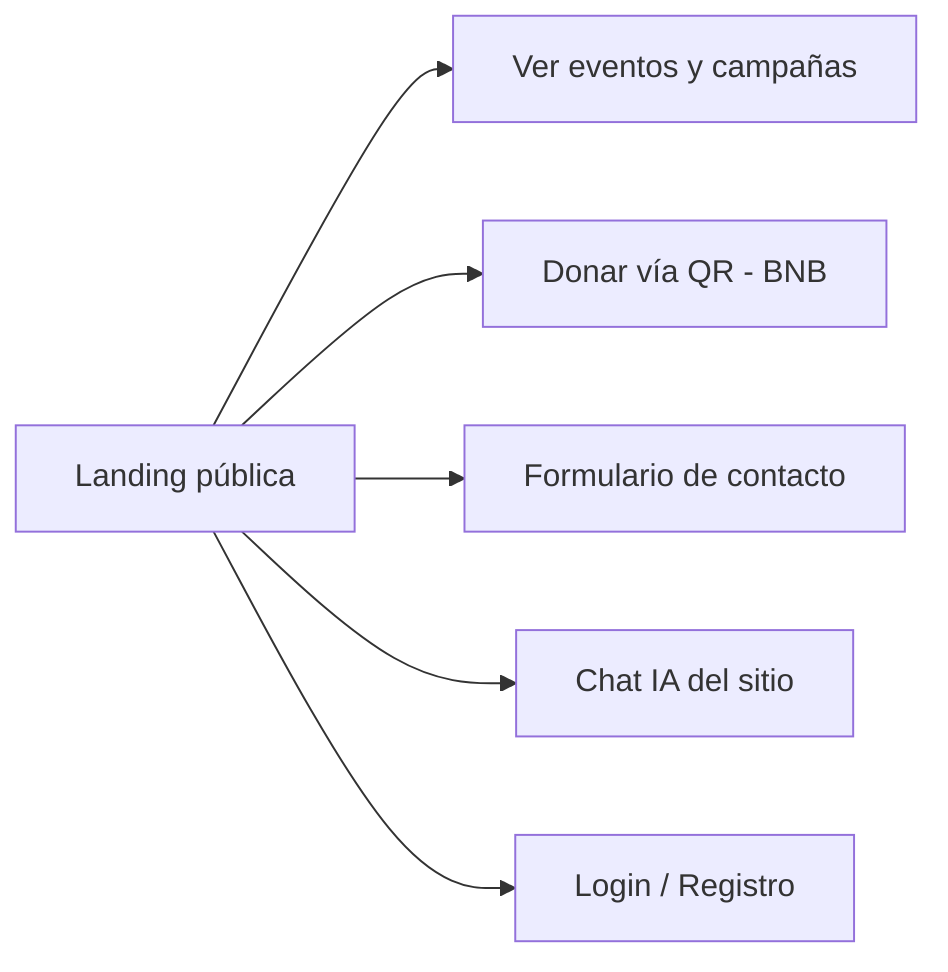
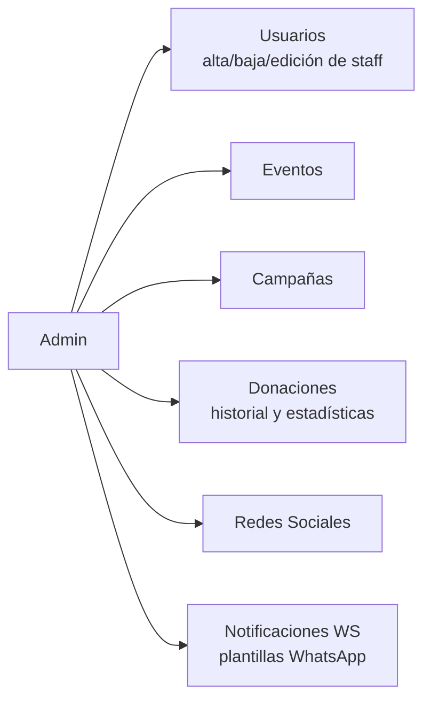
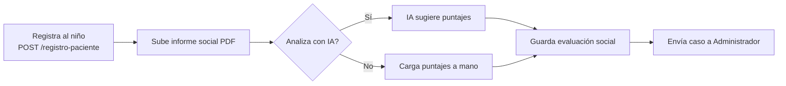
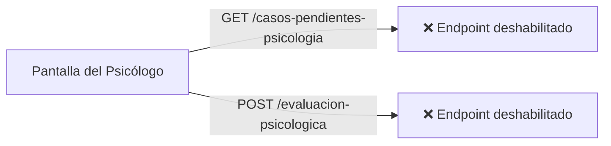
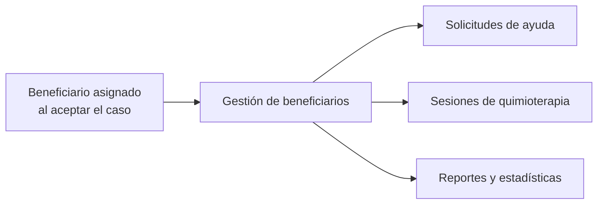
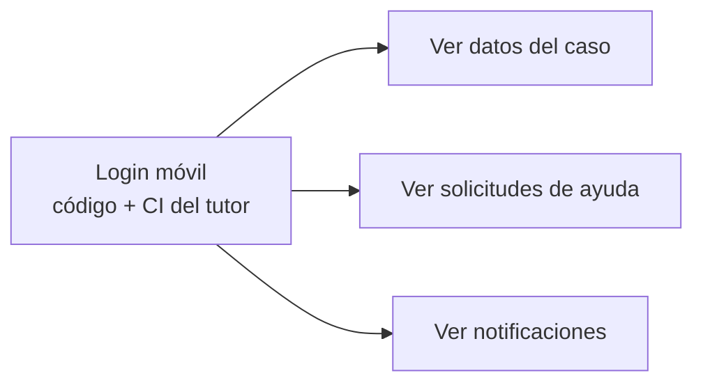
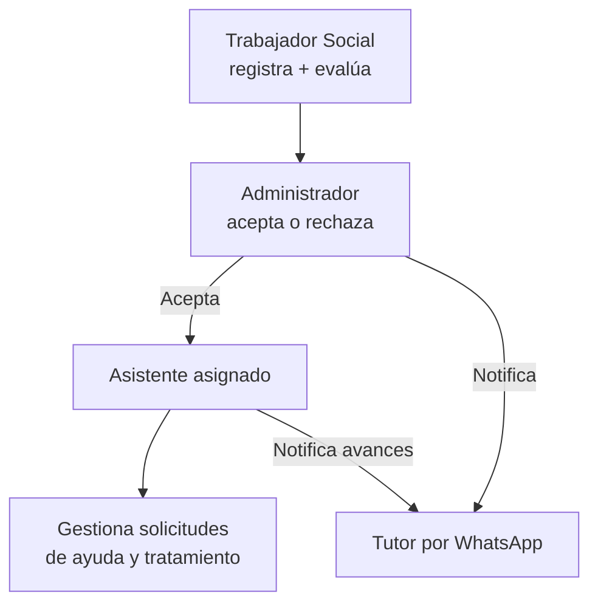

# Flujo general de la aplicación (todos los roles)

Vista de conjunto de todo el sistema: quién entra, qué ve, y qué hace cada rol paso a paso. Los diagramas se mantienen chicos a propósito (uno por rol/módulo) — si querés el detalle fino del proceso de casos, ver [03-flujo-beneficiarios.md](./03-flujo-beneficiarios.md).

## Mapa general de actores

---

## 1. Público (sin login)

Qué hace cada cosa:
- **Ver eventos y campañas**: lectura pública (`GET /evento`, `GET /campana`).
- **Donar vía QR**: genera un QR de pago (`POST /api/bnb/generate-qr`), ver [05-donaciones-pagos.md](./05-donaciones-pagos.md).
- **Formulario de contacto**: `POST /api/contact`, envía un email a `CONTACT_EMAIL` vía el SMTP del backend.
- **Chat IA del sitio**: widget flotante visible en todas las vistas (`POST /api/ai/chat`, sin login), ver [07-ia.md](./07-ia.md).
- **Login / Registro**: el registro (`POST /usuario`) crea una cuenta con el rol que el propio formulario indique — ver el riesgo de seguridad asociado en [09-problemas-conocidos.md](./09-problemas-conocidos.md).

---

## 2. Administrador — módulos fuera de la gestión de casos

(La gestión de casos de beneficiarios ya está detallada en [03-flujo-beneficiarios.md](./03-flujo-beneficiarios.md); acá van los otros módulos del dashboard.)

Qué hace cada cosa:
- **Usuarios**: CRUD sobre `Usuario` (`/usuario`), incluye staff de todos los roles.
- **Eventos / Campañas**: CRUD simple (`/evento`, `/campana`), sin flujo de aprobación.
- **Donaciones**: lectura del historial y estadísticas (`/donaciones`, `/donaciones/estadisticas`); las donaciones se registran solas al confirmarse un pago BNB.
- **Redes Sociales**: publicar/programar en Facebook y Twitter, preparar contenido de TikTok — ver [06-redes-sociales-whatsapp.md](./06-redes-sociales-whatsapp.md).
- **Notificaciones WS**: administra las plantillas de WhatsApp (`/api/whatsapp-templates`) que se usan al aceptar/rechazar un caso.

---

## 3. Trabajador Social

Detalle completo del ciclo de vida del caso en [03-flujo-beneficiarios.md](./03-flujo-beneficiarios.md). El trabajador social también consulta `Historial de Ayudas` (`/reportes/historial-ayudas`) de sus propios beneficiarios asignados.

---

## 4. Psicólogo ⚠️

Este rol **ya no tiene función activa** en el flujo actual — su pantalla sigue existiendo en el frontend pero llama a endpoints que fueron comentados a propósito en el backend quedando fuera del recorrido de un caso. Ver el detalle en [09-problemas-conocidos.md](./09-problemas-conocidos.md).

---

## 5. Asistente

Qué hace cada cosa:
- **Gestión de beneficiarios**: ve solo los beneficiarios que le asignó el admin (`asignadoAId`), con su info médica y social.
- **Solicitudes de ayuda**: crea/aprueba/entrega solicitudes (`PENDIENTE → RECEPCIONADO → ENTREGADO`, o `RECHAZADO`), ver estados en [03-flujo-beneficiarios.md](./03-flujo-beneficiarios.md).
- **Sesiones de quimioterapia**: agenda y actualiza sesiones (`PROGRAMADA → REALIZADA/REPROGRAMADA/NO_ASISTIO`).
- **Reportes**: historial de ayudas con filtros, resumen por beneficiario (`/reportes/*`).

---

## 6. Beneficiario (solo app móvil)

- El acceso web está **bloqueado explícitamente**: `ProtectedRoute` redirige a cualquier usuario con `rol: BENEFICIARIO` a una pantalla de "acceso no permitido".
- El login móvil (`POST /mobile-beneficiario-login`) valida `codigoBeneficiario` + CI del tutor contra `PacienteRegistro`/`Beneficiario` (sistema actual).
- ⚠️ Existe **otro** endpoint de login móvil más viejo, `POST /mobile-login`, que autentica contra el modelo legacy `Padre` y firma el JWT con una clave **hardcodeada en el código** (`"cuno"`, no viene de `.env`). No está claro que la app móvil actual lo use, pero sigue activo — riesgo de seguridad real si algo todavía le pega.

---

## Vista completa: de un caso nuevo a la ayuda entregada

